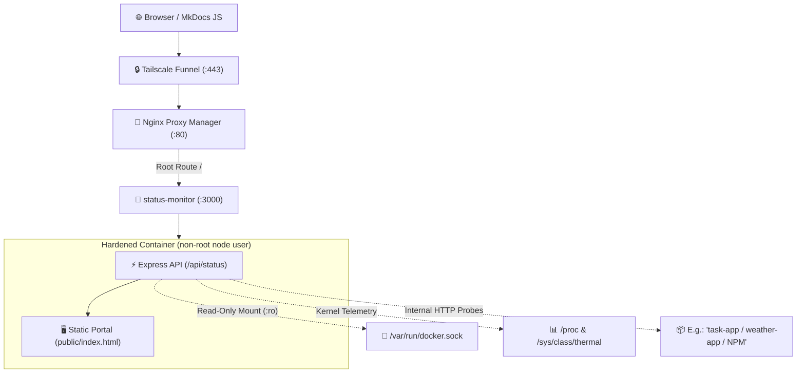

# Home-Lab Status & Container Monitor

<p align="left">
  <a href="https://jhbserver.tail4bcb71.ts.net/" target="_blank">
    
  </a>
  <a href="https://github.com/joaohb07/status-monitor" target="_blank">
    
  </a>
  
  
  
</p>

> **A lightweight, zero-dependency telemetry portal and container monitor** built for a self-hosted Ubuntu home-lab server. Serves as the root landing portal (`https://jhbserver.tail4bcb71.ts.net/`), providing real-time host metrics, Docker container states, internal reverse-proxy health checks, and a CORS-enabled JSON API consumed by external documentation.

---

## 🔗 Quick Links

* **Live Portal & Telemetry:** [https://jhbserver.tail4bcb71.ts.net/](https://jhbserver.tail4bcb71.ts.net/)
* **Live JSON API:** [https://jhbserver.tail4bcb71.ts.net/api/status](https://jhbserver.tail4bcb71.ts.net/api/status)
* **Architecture Documentation:** [joaohb07.github.io/documentation/](https://joaohb07.github.io/documentation/)

---

## 🏗️ Architecture & Security Design



* **Zero-Dependency Docker Engine Client:** Queries `/containers/json?all=1` directly over the Unix domain socket using Node's native `node:http` module—eliminating heavy third-party SDKs.
* **Container Hardening:** Runs as the unprivileged `node` user (`read_only: true`, `no-new-privileges:true`) with the host Docker socket mounted strictly as read-only (`:ro`).
* **Graceful Fallback for Local Environments:** All Linux/Docker-specific probes (`docker.sock`, `/sys/class/thermal`, internal bridge hostnames) fail gracefully, allowing the application and test suite to run locally on macOS, Linux, or CI runners without mocks or extra setup.

---

## 🚀 Setup & Running Locally

### Option 1: Run Natively with Node.js (Fastest for Local Testing)
No Docker daemon or Linux host files are required—missing sockets or thermal sensors automatically degrade to `[]` or `N/A`:

```bash
git clone https://github.com/joaohb07/status-monitor.git
cd status-monitor
npm install
npm start
```

Open **`http://localhost:3000`** in your browser (or inspect **`http://localhost:3000/api/status`**).

### Option 2: Run with Docker
To run the containerized build locally (exposing port `3000` temporarily without Nginx Proxy Manager):

```bash
# Create the shared proxy network if it does not exist locally
docker network create global-proxy

# Build and run the container
docker compose up -d --build
```

*(Note: By default, `docker-compose.yml` does not bind host ports because Nginx Proxy Manager routes traffic internally over `global-proxy`. To access `http://localhost:3000` directly on a local machine, temporarily add `ports: ["3000:3000"]` to `docker-compose.yml`.)*

---

## 🧪 Running Tests & CI/CD

The test suite uses Node's built-in `node:test` and `node:assert` modules with zero external test dependencies:

```bash
npm test
```

* **CI (`.github/workflows/ci.yml`):** Automatically runs `npm test` on every pull request and push to `main`.
* **CD (`.github/workflows/deploy.yml`):** Connects to the private Tailscale network on pushes to `main` and triggers an SSH deployment (`git pull` + `docker compose up -d --build`) on the Ubuntu host.